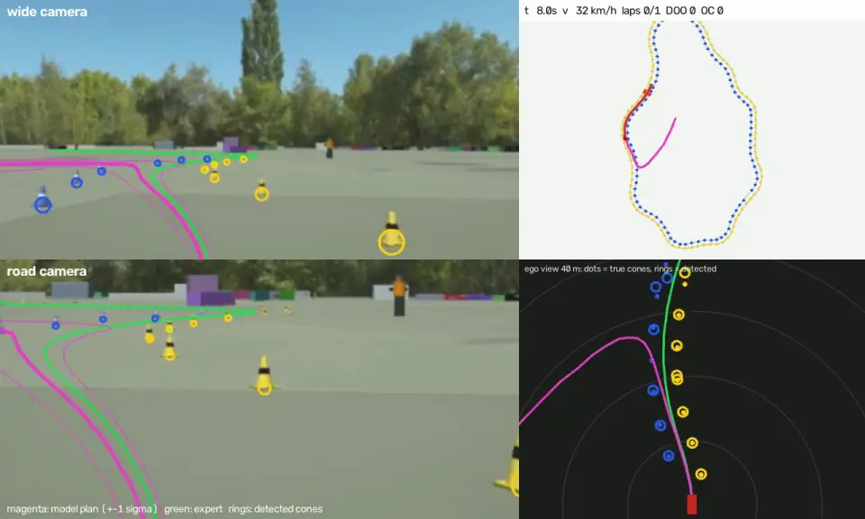

<div align="center">

<picture>
  <source media="(prefers-color-scheme: light)" srcset="/docs/logo_light.svg">
  
</picture>

*Fine-tune openpilot's end-to-end driving model for Formula Student Driverless.*
Camera in → drivable path + cones out. No map, no SLAM.

<a href="docs/media/demo_full.webp"></a>

<sub>Fine-tuned model (`a100_v2_refresh`, trained on a cloud A100) driving a held-out track in the simulator's
venue mode: a clean lap, no cones hit (click for full resolution). Left: model-frame
camera inputs with the predicted path (magenta, ±1σ) vs. the expert (green) and detected cones (rings).
Right: track map and ego view (dots = true cones, rings = detections).</sub>

[](https://github.com/okaynils/fs-openpilot/actions/workflows/ci.yml)


</div>

fs-openpilot takes [openpilot](https://github.com/commaai/openpilot)'s open driving model (MIT) and adapts
it to cone tracks. The pipeline covers:
- tracks generated from the FSG rules;
- a simulator that renders the model's exact camera inputs;
- training on simulation, plus [FSOCO](https://fsoco.github.io/fsoco-dataset/) for the cone detector;
- evaluation with an FSG-style referee;
- ONNX export and a small runtime for the car.

It is meant to be a **framework other FS / FSAE teams can use** with their own car and cameras. It is also
a **living research project**: it improves over time, and every model is recorded in the
[benchmarks](#benchmarks).

> **Status: experimental.** The model drives simulated trackdrive and acceleration runs. It has *not*
> been driven on a real car, and skidpad is not solved yet. This is research software: nothing here
> replaces your team's safety concept, ASR procedures or scrutineering.

## Highlights

- **openpilot's model, unlocked for training.**
  - `driving_supercombo.onnx` is converted to PyTorch with verified parity, about 5e-7 relative error
    against FP32 ONNX.
  - Its plan head is kept and fine-tuned. A cone image head and a BEV cone head are added.
- **Rule-compliant tracks.**
  - Trackdrive and autocross are generated in the curvature domain, with skidpad and acceleration
    layouts, all following FSG 2027 rules section D.
  - A validator and EUFS/FSDS CSV import and export are included.
- **Fast cone-track simulator.** Panda3D renders directly in openpilot's model-frame cameras: about
  200 FPS for both cameras on an M1, with exact pixel geometry.
  - **Driving data:** an expert driver with noise injection, plus counterfactual "recovery" labels.
  - **Referee:** laps, DOO, OC, stop zone, DQ rules.
  - **Domain randomization:** lighting, textures, cones, camera mount, image effects, dynamics.
  - **Venue mode** (`--venue-prob`): real sky panoramas, event asphalt, banner walls, fences, people and
    shadows ([classic vs venue](docs/media/venue_comparison.jpg)). Measured on a real FSG clip with
    `fsop eval real-clip`, it raises cone AP from 0.60 to 0.71 over the classic scenes.
- **Bring your own car.**
  - A **team profile** (`configs/profiles/*.yaml`) describes vehicle parameters, camera mount and
    physical cameras.
  - `fsop camera warp` maps real camera images into the model's inputs; one camera is enough.
- **Deployable.**
  - `fsop export` writes an ONNX file in openpilot's layout, with cone detections appended.
  - `fsop.runtime.FSDriver` turns images into plan, cones and steering/acceleration at 20 Hz. It needs
    only onnxruntime on the car (about 45 ms/step on an M1 CPU).
- **Visualization everywhere.**
  - [Rerun](https://rerun.io) recordings of every validation and closed-loop run, with plans and
    cones projected into the camera views.
  - MP4 and animated WebP/GIF rendering, track galleries.
- **Runs on a laptop, scales in the cloud.** The full pipeline trains on an Apple Silicon Mac (MPS).
  `scripts/modal_app.py` runs the same pipeline on [Modal](https://modal.com): data generation on CPU
  containers, training on a GPU. The current best model cost about $14 of Modal's free monthly credit.

## Quickstart

```bash
git clone https://github.com/okaynils/fs-openpilot && cd fs-openpilot
uv sync --extra sim --group dev            # Python 3.12; torch, onnx2torch, rerun, panda3d
uv run python -m metadrive.pull_asset      # optional: nicer ground textures
uv run fsop model fetch && uv run fsop model prepare && uv run fsop model verify

uv run fsop sim drive --track skidpad      # watch the expert drive in the Rerun viewer
uv run pytest                              # ~10 s
```

Full pipeline (about 2 h on an M1, most of it training):

```bash
uv run fsop track gen --out data/tracks/td_v1 --n 160 --seed 1000      # rule-compliant tracks
uv run fsop sim record --tracks data/tracks/td_v1 --out data/sim/v1    # ~7 min, 6 workers, ~4 GB
uv run fsop data cache-features --dataset data/sim/v1
uv run fsop train --cfg configs/train/mac_stage1.yaml                  # frozen trunk
uv run fsop train --cfg configs/train/mac_stage2.yaml                  # fine-tune trunk + cone heads
uv run fsop bench run --name my_run --ckpt runs/mac_stage2/ckpt/best.pt
uv run fsop viz video --ckpt runs/mac_stage2/ckpt/best.pt --track gen:7 --out runs/demo.mp4
```

## Use it for your team

1. **Describe your car.** Copy [`configs/profiles/example_team.yaml`](configs/profiles/example_team.yaml):
   vehicle geometry and limits, camera mount, camera intrinsics and distortion.
   `fsop camera show <profile>` validates it.
2. **Check your camera mapping.** Run `fsop camera warp --profile <p> --image front=frame.jpg`. It shows
   what the model will see, with the horizon and 10/20 m ground lines drawn in.
3. **Generate data for your car.** Run `fsop sim record --profile <p> …`. The simulator then uses your
   vehicle dynamics and camera height and pitch, randomized around them.
4. **Add real images.** Import FSOCO with `fsop data fsoco-import --src <export>`, then train stage 2
   with `-o fsoco_root=data/fsoco`.
5. **Evaluate in closed loop** with `fsop eval closed-loop --profile <p>` or `fsop bench run`.
6. **Deploy.**
   - `fsop export` produces an ONNX file. On the car, call
     `FSDriver(onnx, profile).step({"front": rgb}, v_ego)` at 20 Hz.
   - The output is a plan, cones (ego frame) and steering/acceleration commands.
   - Your AS state machine still owns go/stop, lap counting and the EBS.

See [docs/team-guide.md](docs/team-guide.md) for details: calibration, single- vs dual-camera setups,
what the model expects, and known gaps.

## How it works

```
 FSG rules ─▶ track generator ─▶ simulator (model-frame cameras, expert + noise, referee) ─▶ dataset
                                                                                              │
 openpilot supercombo (ONNX ─▶ PyTorch) + cone heads ◀── stage 1 (cached features) / stage 2 ◀┘ (+ FSOCO)
                │
                ├─▶ open-/closed-loop benchmarks ─▶ benchmarks/results/*.json
                └─▶ ONNX export ─▶ fsop.runtime.FSDriver on the car (warp → model → plan/cones → control)
```

**Model inputs** (20 Hz):
- two cameras (road and wide), each as two frames 0.2 s apart;
- 1.6 s of feature history;
- a route command (openpilot's *desire* input; used for skidpad).

**Model outputs:**
- a 10 s trajectory with uncertainty;
- cone detections, projected onto the ground with the known camera mount.

Details, design decisions and openpilot-specific findings are in
[docs/architecture.md](docs/architecture.md).

## Benchmarks

Every model gets a record in [`benchmarks/results/`](benchmarks/results). The table below is generated by
`fsop bench table`; the full history with provenance is in [benchmarks/README.md](benchmarks/README.md).
- **Protocol:** open-loop metrics on the held-out test tracks of `data/sim/v1`, plus the closed-loop
  quick suite (3 held-out trackdrive tracks, skidpad and acceleration, light DR, standing start).
- **Pass** means completing all laps, stopping in the zone and not being disqualified.
- See [docs/benchmarks.md](docs/benchmarks.md) for the metric definitions and how to submit a run.

<!-- BENCHMARKS:START -->
| date | name | model | train hw | lat err 1 s / 2 s [m] | ADE 4 s [m] | heading 1 s [°] | cone F1 | trackdrive | accel | skidpad |
|---|---|---|---|---|---|---|---|---|---|---|
| 2026-10-22 | geometric_gt | cone-midline planner on ground-truth cones (privileged) | – | – / – | – | – | – | 3/3 (0.7 DOO) | 1/1 | 0/1 |
| 2026-10-22 | m1_stage1 | supercombo + FS heads, stage 1 (frozen trunk) | Apple M1 16 GB (MPS) | 0.75 / 2.69 | 3.74 | 7.9 | 0.12 | 0/3 (8.7 DOO) | 1/1 | 0/1 |
| 2026-10-22 | m1_stage2 | supercombo + FS heads, stage 2 (last trunk stage fine-tuned) | Apple M1 16 GB (MPS) | 0.43 / 1.57 | 2.60 | 4.1 | 0.40 | 3/3 (7.7 DOO) | 1/1 | 0/1 |
| 2026-10-22 | openpilot_untouched | openpilot driving_supercombo b361e952 (no fine-tuning) | – | 1.28 / 4.64 | 6.28 | 13.0 | – | 0/3 (2.0 DOO) | 1/1 | 0/1 |
| 2026-10-27 | a100_v2_refresh | supercombo + FS heads, stage 2 full-trunk fine-tune on dataset v2 (recovery excursions) + history-refresh pass | Modal A100-40GB | 0.23 / 0.78 | 1.40 | 1.6 | 0.71 | 3/3 (1.3 DOO) | 1/1 | 0/1 |
| 2026-10-27 | a100_v2_s7k | supercombo + FS heads, stage 2 full-trunk fine-tune from m1_stage2 on dataset v2 (recovery excursions) | Modal A100-40GB | 0.25 / 0.87 | 1.60 | 1.9 | 0.70 | 3/3 (2.0 DOO) | 1/1 | 0/1 |
<!-- BENCHMARKS:END -->

`geometric_gt` is a privileged reference: a classic cone-midline planner fed the ground-truth cones,
i.e. perfect perception. It has no open-loop numbers.

## Roadmap

This is my playground. The current focus and the idea backlog are in
[docs/ROADMAP.md](docs/ROADMAP.md), and changes are logged in [CHANGELOG.md](CHANGELOG.md).
Near-term work:
- skidpad (more route-conditioned data);
- fewer cone hits (DAgger, more data);
- FSOCO in the training loop;
- a real-car data path.

## Contributing

Contributions are welcome from teams and individuals: bug reports, track and sim improvements, new
baselines, benchmark runs, team profiles. See [CONTRIBUTING.md](CONTRIBUTING.md).

## Acknowledgements and licenses

- **Code:** MIT. See [LICENSE](LICENSE).
- **openpilot code and model:** MIT, © comma.ai. Ported functions are marked in their docstrings, and the
  model weights are downloaded from the pinned openpilot commit.
- **Optional dependencies:**
  - [MetaDrive](https://github.com/metadriverse/metadrive) assets: Apache-2.0.
  - Ultralytics (optional `yolo` extra): AGPL-3.0.
- **Data:** FSOCO is not redistributed; follow the FSOCO terms. Rule numbers refer to the FSG 2027 rules.
