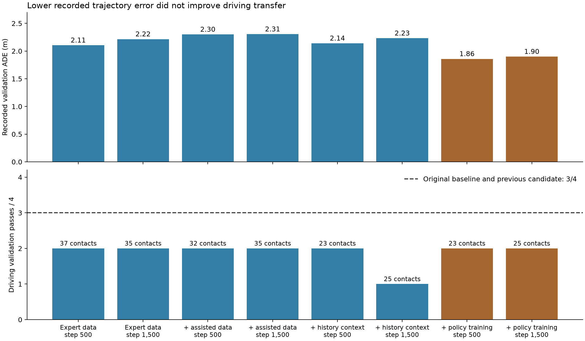

# Recovery and temporal-conditioning experiment — negative transfer result

Starting snapshot: [9a8b496](https://github.com/okaynils/fs-openpilot/commit/9a8b496),
pushed as authorized. This iteration preserves the [v1 report](../transfer/report.md),
checkpoints, datasets and exports. [Predeclared plan](plan.md), [Modal app ledger](modal_runs.json).
Selection was frozen before final-test generation. Final driving, default retention, export parity and fresh-image runtime verification are complete.

## Outcome

**Do not replace the current default.** The bounded pilot, three matched fits and
single predeclared policy-unfreezing fallback did not improve shared-model driving
transfer. The selected expert-only step-500 candidate retains the default trackdrive
benchmark but is worse on the independent final configurations:

| Model | Interpolation passes | Extrapolation passes | Total passes | Contacts | Off-course events |
|---|---:|---:|---:|---:|---:|
| Original baseline | 4/8 | 3/4 | 7/12 | 153 | 22 |
| Previous v1 candidate | 4/8 | 2/4 | 6/12 | 90 | 13 |
| Selected v2 candidate | 4/8 | 1/4 | 5/12 | 140 | 22 |
| Privileged expert | 8/8 | 4/4 | 12/12 | 0 | 0 |

[Raw paired final results](final_driving.json), [driving summary](final_driving_summary.json).
Contacts are actual referee events; passes permit contacts. The same complete profiles,
tracks, seeds, recovery starts and time limits are used for every model. No final
results were used to revise selection or train another model. The requested measured
transfer improvement has **not** been achieved. Implementation and test infrastructure
are useful experimental capabilities, not evidence that calibration alone now suffices.

## Diagnosis and pilot

The [controller probe](control_probe.json), implemented in
[transfer_control_probe.py](../../scripts/transfer_control_probe.py), compares the
same recorded validation observations and vehicle-specific pure-pursuit controller.
Episode-mean steering MAE is 0.0368 rad for the original baseline, 0.0181 for the v1
image-only candidate, and 0.0182 for the v1 minimal conditioned candidate. Their ADEs
are 6.0403, 1.6856 and 1.8651 m. All have zero predicted trajectory-origin offset.
This weakens the hypothesis that average near-term controller error on recorded
expert states explains the candidate's closed-loop regression. It supports testing
coverage of model-visited states; it does not establish causality by itself.

The [pilot generation report](pilot_generation.json) contains 732 new frames in
12 episodes, of which 728 have feasible expert supervision, plus six legacy replay
episodes. Expert takeover occupies 41–100% of the four policy-collected episodes.
The collector is therefore assisted recovery collection, not unconstrained policy
rollouts. [Actual projected observations](pilot_observations.jpg) were inspected
before scaling. [Geometry/event audit](pilot_audit.json) confirms zero trajectory
origin error, continuous camera poses and the pilot's sole contact in its event log.

A separate recording defect was fixed: observations drain events at 20 Hz, so writing
only stored 5 Hz observations could omit contacts. The recorder now writes the
referee's complete log. The pilot's actual event audit passes despite being generated
before this fix; old v1 episodes are preserved and are not retrospectively claimed
to have complete per-frame validity or event coverage.

The first training attempt failed before any optimizer updates because it requested
history-only caches for stage-one training. The retry uses a distinct run name and
full frozen-vision caches. It completed 300 steps: validation ADE 2.843 → 2.122 at
step 100 → 2.259 at step 300. These are pilot diagnostics, not driving selection.
[Validation history](pilot_validation.jsonl), [timing](pilot_timing.json).

[Export/runtime replay](pilot_export_parity.json) checks both Formula and rover
validation episodes over 32 ticks each. Plan-element maximum error is below 5.6e-5,
hidden-feature error below 2.3e-7 and steering error below 1e-7 rad. Images recorded
at 5 Hz are repeated through real 20 Hz queues; this does not replace a fresh-image
closed-loop runtime test. The pilot's ONNX artifact is retained on Modal at
`runs/transfer_pilot_verify_v2/conditioned.onnx`.

Targeted geometry, renderer, supervision, temporal-conditioning, legacy-contract,
staging and provenance tests: **29 passed on Modal**. The three rendering tests
could not initialize a local macOS OpenGL context; they passed in Modal's EGL
environment. Two additional resume-contract tests and the validation-ranking test
passed locally after that run.

Full regression suite: **80 passed in 82.52 seconds on Modal**. The first unscoped
attempt was stopped during discovery without running tests because it traversed the
mounted data volume; its cost remains in the app ledger. The corrected command is
`python -m pytest tests -q`. Modal uploads now include `pyproject.toml` and `uv.lock`,
so test discovery settings and dependency provenance accompany future source archives.

## Full data

The [full generation report](full_generation.json) records 138 episodes, including
5,061 newly rendered frames and 5,040 valid new labels. The 24 expert training
sequences provide 2,253 frames; 24 assisted-policy sequences provide 2,379 frames,
with 21 invalid counterfactual labels excluded. Four new validation sequences provide
429 frames. The remaining 86 episodes are preserved v1 replay with their original
train/validation assignments, including low-speed/start/stop/recovery scenarios.

Mean expert-control fraction across policy-collected episodes is **41.9% for Formula
cars and 94.5% for rovers**. Rover collection is mostly expert driving, so this dataset
provides much less genuine on-policy rover recovery than the collector name might
suggest. Five actual contacts occurred across the Formula policy-collected sequences;
none occurred in expert or rover sequences. [The full audit](full_audit.json) confirms
all contact events are recorded and every trajectory starts at the vehicle origin.
[The full observation mosaic](full_observations.jpg) was inspected before training.

[Actual configuration ranges](configuration_ranges.json) distinguish realized sample
coverage from declared bounds. New installations reach x/y/height bounds for both
families. Intrinsics span approximately 62–89 degrees horizontal FOV; new v2 physical
sensor images are 640×360. Existing v1 replay provides additional image conditions.
“Interpolation” denotes the declared family range, not membership in the convex hull
of the finite training samples. These bounds are not demonstrated deployment guarantees.

## Tracking diagnostic and completed fits

A [validation-only oracle probe](oracle_validation/summary.json), run locally on CPU
without rendering, feeds privileged expert trajectories through the same pure-pursuit
follower used by the learned policies. Both the privileged expert controller and
oracle-plan follower finish **4/4 with zero contacts and zero off-course events**.
Seeds, recovery offsets, complete profiles and time limits match driving validation.
This rules out basic infeasibility of these vehicle/controller combinations; it does
not prove that the follower is robust to noisy, changing learned trajectories.
[Probe source](../../scripts/transfer_v2_oracle.py),
[oracle implementation](../../scripts/transfer_diagnostics.py).

All three predeclared fits completed. Offline validation is frame-weighted on the
same 1,888 samples (22 episodes), including old and new validation configurations:

| Arm | Training samples | ADE at step 500 | ADE at step 1,500 |
|---|---:|---:|---:|
| Expert-only, current conditioning | 7,344 | 2.1054 m | 2.2159 m |
| Added assisted-policy data, current conditioning | 9,678 | 2.3007 m | 2.3054 m |
| Added assisted-policy data, sequence conditioning | 9,678 | 2.1408 m | 2.2320 m |

The shared initialization has ADE 4.9346 m. Added assisted-policy data does not help
this offline score; sequence conditioning improves it relative to current conditioning
on the same data, without beating the expert-only arm at the fixed snapshots.
These are not driving results. Sources: [expert history](transfer_expert_v2_validation.jsonl),
[recovery history](transfer_recovery_v2_validation.jsonl),
[sequence history](transfer_sequence_v2_validation.jsonl).

The [first 12 seconds of the low/forward rover validation case](launch_probe/expert500.json)
show gradual drift: the expert-only step-500 candidate reaches normal speed, but
lateral deviation grows to approximately 1.5 m. Its [projected predictions](launch_probe/expert500.jpg)
differ visibly from the expert corridor; the [previous candidate trace](launch_probe/previous.json)
and [montage](launch_probe/previous.jpg) also drift. This is not an immediate launch
failure, and the oracle follower completes this configuration cleanly. The diagnostic
uses validation seed 98011/5101 and is not final-test evidence.
[Reproduction](../../scripts/transfer_v2_launch_probe.py).

## Results and recommendation

Initial paired driving validation is complete and negative: original baseline 3/4
passes, previous candidate 3/4, new frozen-policy snapshots 1–2/4. No new snapshot
passes either rover case. [Raw paired results](validation.json),
[summary](validation_summary.json), [fixed-rule ranking](initial_selection.json).
The expert passes 4/4 without contacts. The single predeclared low-rate policy-unfreezing
fallback completed 1,500 steps in 118.87 seconds with the same dataset and frozen vision; both snapshots pass only 2/4, with 7 and 3 off-course events respectively. The fixed ranking still selects expert-only step 500; No claim of improved transfer
or default-model replacement is made from the pilot. The original default remains
unchanged. This experiment measures simulator robustness, not real-vehicle readiness.

The expert-only versus augmented-data arm measures the effect of adding these
assisted-policy sequences at a fixed optimizer budget. It also changes sample
weighting and exposure counts; it does not isolate novel-state coverage from those
effects. The current-feature versus sequence-feature comparison uses identical data
and optimizer settings, providing the cleaner architectural ablation.

The policy-unfreezing fallback has offline ADE 1.8589 m at step 500, 1.8996 m at step 1500. [History](transfer_policy_v2_validation.jsonl), [timing](transfer_policy_v2_timing.json). This score does not determine driving selection.

## Interpretation limits

The new architecture keeps the original vision representation frozen. Applying geometry
to history features and modestly adapting policy weights tests two specific capacity
hypotheses; it does not establish that the representation contains enough visual
information for very low or occluded viewpoints. Conditioning cannot restore cones
that are outside the physical sensor view or behind bodywork.

Expert-plan tracking separates basic vehicle/controller feasibility from learned-plan
quality, but it uses privileged map and true-state information. Learned driving also
uses simulator wheel speed, route desire and mission-progress launch/stop assistance.
Completion therefore is not evidence of an entirely camera-only autonomous mission.
Online ADE compares predictions at each policy's own visited states; paired recorded
open-loop observations are needed for a same-state trajectory comparison.

## Frozen selection and packaged runtime

[Combined validation](combined_validation.json) contains 44 unique runs. The merge
verified paired configurations, seeds, recovery conditions, time limits and all
`src/fsop` source hashes; repeated expert outcomes agreed. [Frozen selection](selection.json)
chooses `transfer_expert_v2/ckpt/step_000500.pt`: 2/4 passes, two off-course events and
37 contacts, versus 3/4, one off-course event and 19 contacts for the previous candidate.
The fallback's lower offline ADE does not overcome its poorer driving rank.

The selected research package uses **current-feature** conditioning, not sequence
conditioning. [Artifact identities and parity](artifacts.json) preserve checkpoint,
export, source archive and selection hashes. Both Formula and rover recorded
validation replays pass 120-tick temporal parity: plan maximum absolute error below
5.8e-5, hidden error below 2.8e-7, steer error below 1.8e-7 rad. Repeating 5 Hz images
through 20 Hz queues fills the entire history, but does not substitute for fresh
20 Hz physical-camera runtime evaluation. No default model has been changed.

[Plot source](../../scripts/transfer_v2_plot.py). All offline bars use the same
validation frames; all driving bars use the same four complete configurations.
The dashed line denotes the two references' driving pass counts, not their contact
counts. Neither the assisted-data arm, sequence conditioning, nor the bounded
policy-unfreezing fallback improves validation driving over the previous candidate.

The v2 validation and final suites are different complete configurations and seeds
from the v1 suite that produced 0/12 passes. A v2 pass count must not be presented as
a direct improvement over that old 0/12: the original baseline and previous candidate
are rerun on the identical v2 cases for the actual comparison. Four final configurations
are within the declared family bounds and two deliberately exceed them; two paired
seeds per configuration give eight interpolation and four extrapolation runs per model.

Evaluation advances simulation at 20 Hz independently of wall-clock inference speed.
The driving records include first-call and steady-state p95 latency; an export's
simulated completion cannot establish real-time operation on a team's target computer.
The runtime policy receives fresh physical sensor images and applies deployment
calibration/warping, whereas the training-model policy consumes the simulator's
model-frame observations. Both share the vehicle-specific follower and disclosed
mission launch/stop assistance ([implementation](../../src/fsop/eval/closed_loop.py)).

Online expert ADE is a diagnostic on visited states, including difficult states where
counterfactual expert trajectories may be infeasible. The paired recorded final metric
excludes invalid labels and its first five warmup frames; it is the cleaner same-state
trajectory comparison. Neither metric alone measures safe closed-loop driving.

Final driving uses nominal calibration and no time-varying mount perturbation, while
training includes calibration errors and smooth mount motion. The validation context
ablation changes model metadata while holding recorded images fixed; its ±5 mm
translation perturbation is a sensitivity check, not an end-to-end miscalibration or
vibration qualification. Real calibration error also changes preprocessing, visibility
and bodywork alignment. Those limitations remain even if an offline ablation improves.

The post-selection [final oracle diagnostic](oracle_final/summary.json) completes
**12/12** with expert plans fed through the same pure-pursuit follower and mission
braking. All six rover runs have zero contacts; Formula runs have eight contacts
(one on an interpolation car and seven on the larger extrapolation car). The direct
expert completes 12/12 with zero contacts. Thus rover completion/finish failures are
not intrinsic to these vehicle/follower/mission combinations, while Formula tracking
still has limitations even with privileged trajectories. This does not prove robustness
to noisy learned plans or isolate perception from learned planning.
[Source](../../scripts/transfer_v2_final_oracle.py), [execution provenance](oracle_final/provenance.json).

## Final trajectory, clearance and stability measurements

[Paired recorded final observations](final_open.json) contain 1,040 evaluated frames
(after five warmup frames per episode); all retained labels are valid. ADE below is
frame-weighted within each regime, unlike case-weighted driving metrics.

| Model | Interpolation ADE | Extrapolation ADE | Predicted-contact frame rate, interpolation / extrapolation |
|---|---:|---:|---:|
| Original baseline | 6.979 m | 6.177 m | 55.68% / 53.57% |
| Previous candidate | 2.083 m | 1.667 m | 50.85% / 33.93% |
| Selected candidate | 2.058 m | 1.679 m | 52.41% / 33.04% |

Predicted contacts are overlap of a planned footprint with cones within four seconds,
not actual driving contacts. The selected candidate gains **zero** final passes that
either reference loses; it loses two baseline passes and one previous-candidate pass.
[Paired outcome counts and complete metrics](final_summary.json),
[aggregation source](../../scripts/transfer_v2_final_summary.py).

| Model | Worst actual clearance | Mean RMS steer rate | Mean 1 s tracking error | Recovery lateral error, 4–6 s |
|---|---:|---:|---:|---:|
| Original baseline | −0.898 m | 0.0736 rad/s | 3.796 m | 0.789 m |
| Previous candidate | −0.888 m | 0.0573 rad/s | 0.606 m | 0.776 m |
| Selected candidate | −0.904 m | 0.0618 rad/s | 0.959 m | 1.063 m |

Recovery means use the six offset-start cases. Steering saturation is zero for all
three models; failure is not explained by persistent steering-limit clipping. Tracking
error compares the executed position with the model's earlier predicted position and
therefore mixes trajectory consistency with follower performance. The candidate is
worse than v1 on recovery error, tracking error, contacts and valid completions.

Observed candidate failures comprise five timeouts, one unsafe stop without a valid
lap, and one nominal finish without a valid lap after leaving the course. Full route
progress alone can hide these last two failures. Both low-rover seeds and all other
rover cases fail. Mean visible cone counts fall below three on the rear rover and
extrapolation rover, but those are averages over failed trajectories: they cannot
separate initial visibility limits from visibility lost after a prediction error.
The low/forward rover still sees roughly 8–10 cones on average and fails. Oracle-plan
tracking succeeds on every rover, supporting a policy/trajectory limitation rather
than basic vehicle infeasibility. Final calibration is nominal, so these are not
injected-calibration-error failures. Finish and lap logic contribute to the reported
outcome but are not shown to be defective by these tests.

## Conditioning and default retention

The [validation-only context ablation](context_ablation.json) reports episode-mean
ADE 2.273 m with calibrated metadata, 2.633 m with default camera translation,
5.652 m with default vehicle parameters, and 3.453 m with default speed limit.
Thus metadata affects metric prediction, but this does not demonstrate better driving.
Replacing response delays with defaults improves this offline score to 2.071 m;
there is no evidence here that every existing contract field is beneficial. No new
fields were added in v2. ±5 mm metadata perturbations give 2.271/2.275 m. These
interventions are diagnostic and were not used to tune the selected checkpoint.

[Default open-loop ADE](default_open.json) is **1.3851 m**, versus the preserved strict
baseline's [1.3905 m](../transfer/default_baseline_strict_open_loop.json).
[Default driving](default_closed.json) retains **3/3 trackdrive completions, two contacts,
zero off-course events**, matching the baseline. Acceleration passes with no contacts.
Skidpad still fails: candidate 24 contacts / 6 off-course events, baseline 23 / 8;
the previous candidate also failed (18 / 1). The declared trackdrive/ADE retention
gate passes, but that does not repair the failed transfer gate or establish skidpad
competence. [Baseline driving](../transfer/default_baseline_strict_closed_loop.json),
[previous-candidate driving](../transfer/default_minimal_closed_loop.json).

## What changed, and what the result rules out

The implementation adds coherent assisted-policy collection with per-frame supervision
validity, versioned extreme-placement designs, full event recording, temporal geometry
conditioning with legacy compatibility, named checkpoint snapshots, and paired
closed-loop selection. See [collector](../../src/fsop/sim/transfer_collection.py),
[design/generation](../../scripts/transfer_v2_experiment.py),
[model](../../src/fsop/model/build.py), [trainer](../../src/fsop/train/trainer.py),
[runtime](../../src/fsop/runtime.py), and [selection](../../scripts/transfer_v2_select.py).
No new geometry input fields or team-specific integrations were introduced.

The bounded evidence does **not** support adding more of the same assisted data or
switching to sequence conditioning as a fix. Nor did low-rate policy adaptation help.
It rules out a gross trajectory-origin error and an export mismatch, and weakens basic
vehicle/controller infeasibility as the explanation for rover failures. It does not
isolate visual representation quality from learned planning or prove a particular next
architecture will succeed. A future independent iteration should first measure cone
localization/near-term path consistency at low viewpoints and collect genuine recovery
states with less overwhelming expert intervention, then compare against the strong
original baseline using closed-loop validation. That is a recommendation, not an
experiment claimed to have been run here. This final suite is now disclosed and must
not be reused as an untouched test set for that iteration.

## Deployment runtime result

[Fresh-sensor driving](runtime.json) uses the fixed Formula/rover subset at 20 Hz,
with the same profiles, seeds and recovery offsets for PyTorch and ONNX. Both pass
**1/2**: Formula has one valid lap and 18 contacts, rover has no valid lap and six
contacts despite full progress. Off-course counts differ on the rover (5 PyTorch,
3 ONNX); these are not identical closed-loop trajectories. Formula RMS lateral error
is 0.796/0.793 m and rover error is 2.156/1.523 m respectively.

The follow-up [identical fresh sequence check](fresh_parity.json) holds expert-driven
states and physical images fixed for 120 ticks per configuration. Maximum plan-element
error is 0.000182 for Formula and 0.000045 for rover; steering error is below 2e-7 rad.
Together with the recorded-history parity, this supports small numerical differences
amplifying in unstable closed-loop driving rather than a gross input/queue mismatch.
It does not prove full trajectory equivalence. [Probe source](../../scripts/transfer_v2_fresh_parity.py).

Steady-state policy p95 is 16.5/16.4 ms for PyTorch and 39.8/40.1 ms for ONNX on the
two cases. First calls take about 0.61–0.74 seconds. These measurements describe this
Modal environment, not a rover computer; they exclude the simulator's rendering and
are not end-to-end hardware qualification. [Post-selection provenance](post_selection_provenance.json)
verifies evaluator source against the preserved package, and all downloaded package
hashes were checked.

## Compute, checks and artifacts

Training used the existing Modal infrastructure (A100-40GB for fits; L4/A10 fallback
selection for GPU collection/evaluation), with at most three active collection or
evaluation workers. The three main fits took 111.51, 109.58 and 113.41 seconds;
the single policy fallback took 118.87 seconds, plus the 31.52-second pilot fit.
Driving validation used 4,751.59 worker-seconds, its fallback 1,410.25, and independent
final driving 5,876.49. [Measured stage durations](measured_compute_seconds.json)
exclude startup and are not billed GPU allocation time.

[Metered app-scoped costs](modal_metered_costs.json) total **$7.56217844** at the 2026-11-14 15:13 UTC refresh. This supersedes the
earlier partial $5.94176108 report and now includes the 14:00 UTC interval. It is
metered app-scoped usage, not an invoice. The ledger includes the failed pre-update
pilot and stopped discovery-only test attempt, rather than hiding their costs.
[Every Modal app](modal_runs.json) has its identifier and final status; no experiment
jobs remain running. Local CPU oracle diagnostics and artifact downloads are not
included in GPU work durations. Refresh billing against the listed app IDs for a final
invoice comparison; do not interpret unsettled usage as free.

The full regression suite passed **80 tests on Modal**. Four selection/resume tests
were rerun locally and passed. New scripts pass Ruff, and `git diff --check` passes.
Source-linked geometry, validity-mask, profile, temporal-conditioning, compatibility
and provenance tests are in [tests](../../tests). Actual pilot/full images were
inspected before scaling training. A report-link check was also completed.

The selected research checkpoint, ONNX export and source archive are downloaded and
SHA-256 verified; [artifact manifest](artifacts.json) records their exact identities.
All training checkpoints, optimizer state where saved, feature caches, datasets,
source archives and failed-run provenance remain on Modal under distinct names.
[Reproducible commands and locations](commands.md). The pushed starting snapshot is
`9a8b496`; this subsequent iteration remains uncommitted and unpushed. No release,
default-model replacement or team-specific integration was made.
